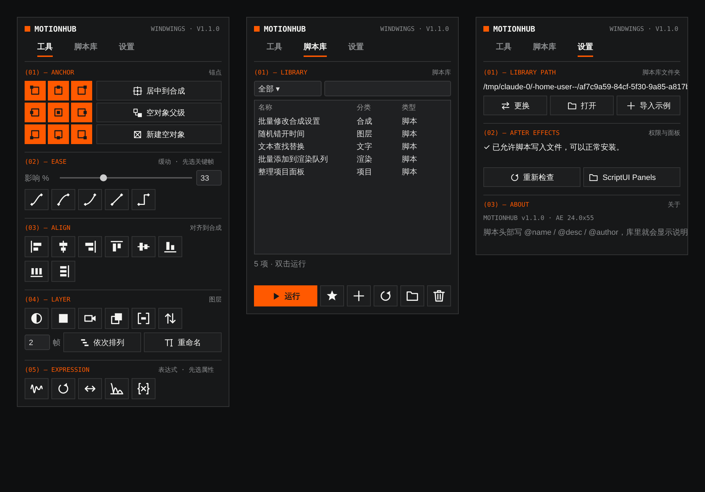
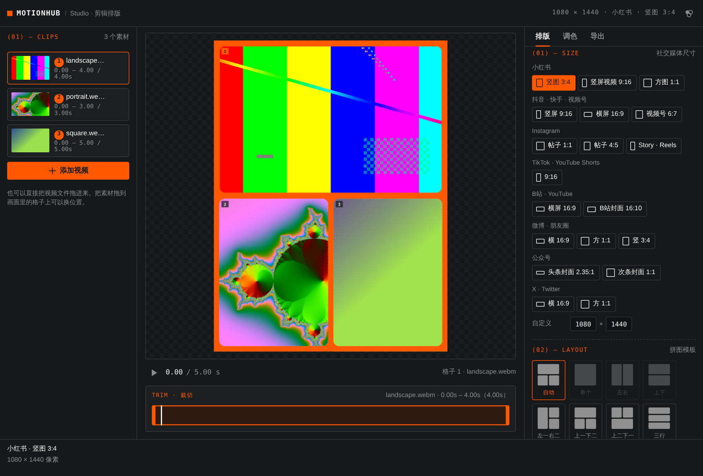

# MotionHub —— AE 脚本插件合集平台

风翮 windwings 出品的 After Effects 扩展面板（CEP）。它是一个可以自己搭建的动画工作台：

- **智能组件**：缓动滑块、可拖动手柄的**缓动曲线编辑器**（可从关键帧读取、保存自己的预设）、关键帧复制 / 粘贴 / 克隆 / 反转 / 均分 / 拉伸 / 微移、**快速入场 / 出场动画**、Num / Step 依次排列、锚点九宫格
- **音乐节拍**：分析音频节拍和 BPM，加节拍标记、把图层吸附 / 排列到节拍上，点波形试听
- **样式复制**：把一个图层的效果（含关键帧和速度曲线）、变换、混合模式粘贴到其他图层，关键帧可按新图层长度自动适配
- **效果收藏**、**一键新建 7 种图层**、**解散预合成**、**独立复制预合成**、**智能重命名**、**首尾相接**
- **命令搜索**：在面板里按 Cmd/Ctrl + K，搜索全部工具、脚本和代码片段
- **Studio · 剪辑排版**：多个视频裁切后自动拼图排版，覆盖小红书、抖音、Instagram 等社交媒体尺寸，带曲线 / 色彩平衡 / 色阶调色，导出 GIF、MP4 或可编辑的 AE 合成
- **自定义布局**：点右上角 ✎ 进入编辑模式，**拖动排序**、给每个组件**换颜色**、删除，从组件库添加工具、脚本和代码片段
- **多面板**：最多 **4 个独立面板**，各自保存布局和主题色，可以分成"动画""整理""我的脚本"等不同工作区
- **脚本整理**：脚本文件按分类管理，可以**直接拖进面板**；「添加表达式」和「执行脚本」两类**代码片段**，粘贴代码即可一键使用

支持 After Effects 2022 及以上（Windows / macOS）。



---

## 安装

1. 解压后，保持 `com.windwings.motionhub` 文件夹和安装脚本在同一个目录。
2. 运行对应系统的安装脚本：
   - **macOS**：双击 `安装-Mac.command`。如果提示"无法打开"，就右键 → 打开 → 再点一次「打开」。
   - **Windows**：双击 `安装-Windows.bat`。
3. **完全退出** After Effects 再重新打开，然后在菜单 **窗口 → 扩展 → MotionHub**（以及 MotionHub 2 / 3 / 4）打开面板，拖进工作区停靠。
4. 第一次使用前，请在 AE **首选项 → 脚本和表达式** 里勾选 **「允许脚本写入文件和访问网络」**，否则无法添加脚本。

安装脚本做了两件事：

- 把插件复制到扩展目录：
  - macOS：`~/Library/Application Support/Adobe/CEP/extensions/`
  - Windows：`%APPDATA%\Adobe\CEP\extensions\`
- 开启 Adobe 的 `PlayerDebugMode`，允许加载没有签名的扩展。

**卸载**：删除上面扩展目录里的 `com.windwings.motionhub` 文件夹即可。

> 如果之前装过旧版 `MotionHub.jsx`（ScriptUI 面板），请把它从 `Scripts/ScriptUI Panels` 里删掉，以免和新版混淆。

---

## 使用

### 多面板

在 **窗口 → 扩展** 里有 4 个面板：**MotionHub、MotionHub 2、MotionHub 3、MotionHub 4**。每个面板的布局、名称和主题色单独保存，可以同时打开，停靠在不同位置。默认预设分别是：

| 面板 | 默认布局 |
| --- | --- |
| MotionHub | 主面板：全部工具 |
| MotionHub 2 | 动画：缓动曲线 · 关键帧 · 快速动画 |
| MotionHub 3 | 整理：锚点 · 对齐 · 图层 · 合成颜色 |
| MotionHub 4 | 我的脚本 |

在「设置」页可以改面板名称、主题色，或者载入别的预设。

### 自定义布局

1. 点右上角 **✎** 进入编辑模式。
2. **拖动**任意组件调整顺序；点 **●** 换颜色（品牌色板或自定义颜色）；点 **×** 从面板删除；章节标题点 **✎** 改文字。
3. 点 **添加组件** 打开组件库：智能组件、单个工具、脚本库里的脚本、代码片段都可以加。
4. 点 **完成**（或按 Esc）退出。

### 提示栏与修饰键

鼠标移到任意按钮上，面板底部会显示它的用法。很多按钮按住修饰键点击有不同功能：

| macOS | Windows |
| --- | --- |
| ⌥ Option + 单击 | Alt + 单击 |
| ⇧ Shift + 单击 | Shift + 单击 |
| ⌘ Command + 单击 | Ctrl + 单击 |

所有操作都能用 Cmd/Ctrl + Z 一步撤销。在面板里按 **Cmd/Ctrl + K** 可以搜索并运行任何工具、脚本或代码片段。

> 从旧版本升级时，已经保存的面板布局不会自动加入新组件：可以点 ✎ →「添加组件」手动加，或者在「设置」里「载入预设布局」。

### 智能组件

| 组件 | 功能 |
| --- | --- |
| 新建图层 | 文字、形状、纯色、调整图层、空对象、摄像机、灯光，一键新建在选中图层上方 |
| 锚点九宫格 | 单击把锚点移到图层对应位置（图层不动）；⌥ 同时把图层贴到合成对应位置 |
| 缓动 | IN / OUT 影响滑块 + 缓入缓出（⌥ 只缓入，⇧ 只缓出）、线性、定格 |
| 缓动曲线 | 拖动两个手柄编辑 cubic-bezier，8 个预设（平滑、三次、五次、指数、缓出、缓入、回弹、预备）；应用到选中关键帧，⌥ 镜像应用；**从两个关键帧读取曲线**，**保存为自己的预设**（4 个面板共用，⌥ 单击自己的预设可删除） |
| 关键帧 | 复制（显示已复制数量）、粘贴到播放头（选了属性就粘到属性，只选图层就粘到同名属性；⌥ 反向，⇧ 粘贴后选中）、克隆、反转、均分、按倍数拉伸（⌥ 压缩）、左右微移 N 帧（⇧ 10 倍） |
| 快速动画 | 透明度、缩放弹出、滑动（4 个方向）、旋转、模糊；「入场」从播放头开始，「出场」在播放头结束，自动加缓动 |
| 依次排列 | Num 个一组、Step 帧间隔；正序 / 倒序 / 从中间向两边 / 随机 |
| 音乐节拍 | 选中音频（或带声音的视频）图层后点「载入」：显示波形、节拍和 BPM，只分析图层可见的那一段；可调灵敏度和最小间隔；节拍标记（⌥ 加到合成上，⇧ 带编号）、清除标记、吸附到节拍、按节拍排列（每 N 拍一个图层，⌥ 同时剪出点，做卡点剪辑）；点波形试听 |
| 样式复制 | 复制选中图层的样式，按勾选的内容（效果、关键帧、适配长度、变换、混合、替换已有效果）粘贴到其他图层 |
| 效果收藏 | 常用效果一键添加到选中图层，⌥ 加在新的调整图层上；「管理」里从已安装的全部效果中挑选收藏 |

### 工具按钮

| 分组 | 按钮 |
| --- | --- |
| 锚点 · 对齐 | 居中到合成、6 个方向对齐（⌥ 对齐到选区）、水平 / 垂直分布 |
| 图层 | 空对象（⌥ 设为父级）、逐个预合成、**解散预合成**（画面位置不变，⌥ 同时删除原合成）、**复制预合成（独立副本）**（改副本不影响原件，⌥ 连嵌套的也独立复制）、**智能重命名**（按内容起名，⌥ 全部图层，⇧ 加类型前缀）、**首尾相接**（⌥ 从播放头开始，⇧ 倒序）、调整层、纯色、摄像机、文字、形状、灯光、剪到工作区、在播放头拆分、移到播放头（⌥ 出点对齐）、反转顺序、运动模糊开关、批量重命名 |
| 关键帧 | 缓入缓出、线性、定格、克隆、反转（可单独放进面板） |
| 表达式 | 抖动（⌥ 加滑块控制）、循环（单击 Cycle / ⌥ Ping-Pong / ⇧ Continue / ⌘ Offset）、弹性、清除 |
| 合成 · 颜色 | 复制合成并更新表达式引用、收集颜色到控制器（⌥ 只收集不关联） |

### 线框叠加：让图层边界和摄像机运动出现在成片里

AE 里的图层边框、锚点、运动路径只是界面显示，渲染出去就没有了。「线框叠加」组件会把它们做成**真正的图层**，所以导出视频里也能看到，不用再录屏：

| 选项 | 效果 |
| --- | --- |
| 边界框 | 每个图层的外框，用表达式实时跟踪，3D 图层会跟着摄像机透视变形 |
| 锚点 | 锚点位置的十字 |
| 运动轨迹 | 锚点走过的路线（虚线）；打开「轨迹随时间生长」就是边走边画的拖尾效果 |
| 图层名 | 在外框左上角标出图层名 |
| 3D 地面网格 | 一张跟着摄像机透视的地面网格，摄像机一推一摇都看得出来 |
| 摄像机信息 | 左上角显示时间码、摄像机位置和缩放 |
| 安全框 | 动作安全框、字幕安全框和中心十字 |

单击给选中图层生成，⌥/Alt 单击给所有显示中的图层生成。所有线框共用一个「MH 线框控制」空对象：在它的效果控件里改颜色、线宽、不透明度，全部线框一起变；组件里的取色按钮可以直接换成品牌色。「清除线框」会删掉 MotionHub 生成的全部线框图层，原来的图层不受影响。

### 脚本库

- **脚本文件**：脚本库就是一个普通文件夹（默认 `文稿/MotionHub/Library`），每个子文件夹是一个分类。点「添加脚本」或者**直接把 .jsx / .jsxbin / .ffx 拖进面板**，可以同时放到当前面板上。鼠标移到某一行会出现：放到当前面板、在文件夹中显示、移除、运行。
- **代码片段**：分「添加表达式」和「执行脚本」两组，点 ＋ 粘贴代码就能保存。表达式片段应用到选中属性（⌥ 追加到已有表达式），脚本片段直接执行。片段存在脚本库的 `_snippets.json` 里，跟着脚本库一起同步。
- 在脚本开头的注释里写 `@name` / `@desc` / `@author`，库里就会显示名称和说明。
- 「设置」里可以把脚本库换成网盘同步文件夹，多台电脑共用。

---

## Studio · 剪辑排版



在 **窗口 → 扩展 → MotionHub Studio · 剪辑排版** 打开（主面板「新建图层」里的「打开 Studio」按钮也可以）。这是一个大窗口，左边放素材，中间预览，右边分「排版 / 调色 / 导出」三页。

**素材与裁切**

- 点「添加视频」或者直接把视频拖进窗口。面板能预览 H.264 / VP9 等常见编码；ProRes、HEVC 这类编码需要先转成 H.264 MP4。
- 点「**导入 AE 合成**」可以直接用项目里的合成：选一个合成，AE 会自动把它（或它的工作区）渲染成帧序列放进素材，不用先手动导出视频。可选半分辨率，做 GIF 时更快。这样放进去的合成在「发送到 AE」时会直接引用原合成。
  - AE 不允许把项目面板里的东西直接拖进扩展面板，所以用这个按钮代替拖拽。
- 选中一个格子后，下面的时间线就是这个格子的素材：拖动橙色框的两端设入点 / 出点，拖中间整体移动。
- 把左边的素材拖到画面里的某个格子上就能换位置；点一下素材，会放进当前选中的格子。

**排版**

- **社交媒体尺寸**：小红书（3:4、9:16、1:1）、抖音 / 快手 / 视频号（9:16、16:9、6:7）、Instagram（1:1、4:5、Story / Reels）、TikTok / Shorts、B 站 / YouTube（16:9、封面 16:10）、微博 / 朋友圈、公众号封面（2.35:1、1:1）、X，也可以自定义像素。
- **拼图模板**：默认「自动」，按素材数量和画面方向挑选；也可以手动选单个、左右、上下、左一右二、上一下二、上二下一、三行、三列、田字、一大三小、左一右三、四行、二加三、二乘三、三乘二、九宫格。
- **样式**：间距、边距、圆角、背景色（品牌色板或自定义颜色）。
- **构图**：在画面里拖动调整、滚轮缩放、双击复位；也可以选「填满」或「完整」。

**调色**（可以只调当前素材，也可以同时作用于全部素材）

- **风格**：原图、暖阳、冷调、胶片、高对比、柔和、品牌橙。
- **色阶**：直方图 + 输入黑 / 伽马 / 输入白 / 输出黑 / 输出白。
- **曲线**：RGB 总曲线和红绿蓝单通道，点击加点、拖动调整、双击删除。
- **色彩平衡**：阴影 / 中间调 / 高光分别调青—红、品—绿、黄—蓝，可以保持亮度。

**导出**

| 按钮 | 做什么 |
| --- | --- |
| 导出 GIF | 面板直接生成循环 GIF，帧率 10–25、宽度 360 / 540 / 720 / 原尺寸，可选抖动 |
| 导出 MP4 | 面板逐帧渲染成 PNG 序列，AE 导入后加进渲染队列（AE 2023 及以上用 H.264，否则输出 MOV），可以带上某段素材的声音 |
| 发送到 AE | 在 AE 里搭出同样的排版：背景纯色 + 每个格子一个预合成，裁切、构图、圆角蒙版、循环都保留，带色阶和色彩平衡效果，可以继续编辑 |
| 导出封面 PNG | 当前画面按原尺寸存成 PNG |
| 导出实况照片 | **顶栏右上角「导出实况」随时一键导出**，导出页第一项也是它。生成一个 `IMG_xxxx.pvt` 实况照片包（Apple 的 Live Photo 包格式，Mac 上显示为一个文件，双击或拖进「照片」就是一张实况照片）。Mac 上默认导出后直接存入「照片」App，开了 iCloud 照片会同步到 iPhone；导出时还会用系统自带的 ImageIO / AVFoundation 读回配对标识做校验。封面用滑块或时间旁的「设为封面」选，选的时候画面会跳到那一帧。视频由 AE 渲染成 H.264，需要 AE 2023 及以上 |

> 曲线没办法用脚本写进 AE 的「曲线」效果，所以「发送到 AE」的合成里只有色阶和色彩平衡；GIF 和 MP4 的调色与预览完全一致。
>
> 实况照片：JPG 的 EXIF 里写入 Apple MakerNote 内容标识，MOV 里写入同一个 `content.identifier` 和 still-image-time 元数据轨（封面时刻），影片时间基统一为 60000，再打包成 `.pvt`（照片 + 视频 + `metadata.plist`）。结构与 LiveCanvas 在 macOS PhotoKit 上验证过的输出一致，并用它的 `verify_pair` 校验通过。写法改写自 video-to-live-photo（Apache-2.0）和 LiveCanvas（MIT），许可证见 `third_party/video-to-live-photo/`。第一次存入「照片」时 macOS 会询问是否允许 After Effects 控制「照片」，选「好」；如果点了拒绝，到 系统设置 → 隐私与安全性 → 自动化 里打开。Windows 上 `.pvt` 是一个文件夹，整个传到 Mac 再导入。

## 视觉规范（风翮 windwings）

- 四色：画布 `#171819`、唯一强调色 `#FF5900`、橙的暗部 `#26110A`、白；文字 `#F4F4F2` / 副文 `#8A8C8E`
- 字体：Geist / Geist Mono（联网时自动加载，离线时回退到系统字体）
- 章节头 `(01) — ANCHOR` 用橙色等宽字，分隔只用 1px 线，不用阴影
- 橙色块上一律用近黑图标和文字（白字对比度不达标）
- 交互：悬停时按钮变亮、图标变成强调色；按下时缩小到 0.96
- 可以给每个面板换主题色、给每个组件单独上色；色块上的文字会自动选近黑或白，保证对比度

## 文件结构

```
MotionHub/
├── com.windwings.motionhub/   插件本体
│   ├── CSXS/manifest.xml      扩展声明（4 个面板）
│   ├── index.html · css/ · js/  面板界面（布局引擎、组件、脚本库）
│   ├── studio.html · js/studio.js  Studio 剪辑排版（js/grade.js 调色、js/gif.js GIF 编码、js/livephoto.js 实况照片）
│   ├── third_party/           第三方许可证
│   ├── jsx/host.jsx           在 AE 里执行的工具和脚本库逻辑
│   └── library_seed/          首次启动导入的示例脚本
├── 安装-Mac.command
└── 安装-Windows.bat
```

## Studio 的三条时间

- **成片时间线（OUTPUT）**：整条就是最后输出的实况照片 / GIF / MP4。默认长度取裁切后最长的那个格子，也可以固定（比如 3 秒）。橙色星标是**封面**——实况照片不按住时显示的那张静态图，拖星标或点「设为封面」来换。
- **裁切（TRIM）**：只管当前选中的格子，决定这个格子从原视频里取哪一段；比成片短的格子会循环。
- 实况照片建议 3 秒以内，成片超过 3 秒时时间线上会提示，点「改为 3 秒」即可。

## 不装 AE 也能用：浏览器版 Studio

双击压缩包里的 **「MotionHub Studio（浏览器版）.html」**，用 Chrome 或 Edge 打开即可。浏览器版可以添加视频、排版、拖动构图、裁切、调色、导出 GIF 和封面 PNG；导出 MP4、实况照片、发送到 AE、导入 AE 合成需要在 AE 里用。

## 更新后界面没变？

1. 用**新压缩包**里的安装脚本重新安装（脚本会自动清除扩展缓存）；
2. 安装前完全退出 AE（Mac 上 Cmd+Q），装完再打开；
3. 看 Studio 左上角的版本号，和压缩包对应才说明装上了新版。
